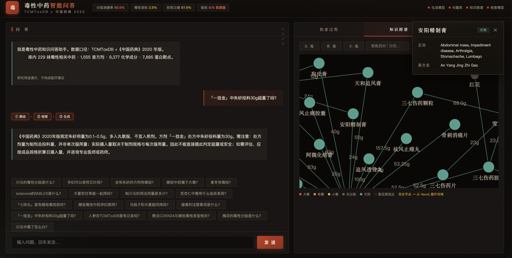

# TCMToxDB · 毒性中药垂直问答系统

[English](../README.md) | 简体中文

> **状态：第一轮 SFT（8/9 验收）+ RAG 检索层（五轮迭代，系统级验收 9/9）均已完成。**

从 TCMToxDB 4 张表 +《中国药典》2020 年版出发：毒性分级清洗 → 处方解析 → 多任务 SFT 数据
→ Qwen3.5-9B LoRA 微调 → RAG 检索层（Qdrant + Neo4j 知识图谱）→ 流式问答服务与可视化界面。



> 左：问题「一捻金中朱砂投料30g超量了吗？」——模型按训练口径给出**保守回答**
> （区分投料量与日服量，不下断言结论）；右：知识图谱交互探索（方剂-药材-配伍禁忌，
> 药签属性卡展示主治与英文名）。

## 系统级评测结果（test 393 条，实体分组切分）

| 指标 | 基座 | 纯 SFT | **SFT + RAG（最终）** | 验收线 |
|---|---|---|---|---|
| 分级准确率（药典校正口径） | 4.8% | 90.5% | **90.5%** | ≥85% ✅ |
| 毒性误标率 ⚠ | 60% | 7.5% | **5.0%** | ≤8% ✅ |
| T6 拒答正确率 | 47.6% | 97.6% | **97.6%** | ≥85% ✅ |
| 误拒率 | 0% | 4.8% | **4.8%** | ≤10% ✅ |
| T5 保守性（不下断言） | 22.2% | 100% | **100%** | ≥90% ✅ |
| think 泄漏率 | 100% | 0% | **0%** | ≤2% ✅ |
| 冲突 17 味准确率 | 0% | 85.7% | **85.7%** | ≥85% ✅ |
| SMILES 精确匹配 | 5.9% | 5.9% | **52.9%** | ≥40% ✅ |
| CAS / PubChem 精确匹配 | 0% | 0% | **50% / 54.5%** | ✅ |
| 开放式字符 F1 | 0.105 / 0.417 | 0.801 | **0.664** | ≥0.55 ✅ |

- 分级准确率轨迹：基座 4.8% → few-shot 14.3% → SFT **90.5%**（+RAG 保持不回归）
- SFT+RAG 在保持纯 SFT 全部能力的同时，将标识符问答从 0% 拉到 50%+，误标率进一步压低

## 系统架构

```
用户提问 → 实体路由器（守卫优先：4 层拒答保护 + 注入过滤 + 分级纯模型路径）
  ├─ 标识符/安全类 → 精确查表（19,099 条语料字典）
  ├─ 语义/列举类  → Qdrant 向量召回（bge-m3）→ bge-reranker 精排
  ├─ 关系反查     → Neo4j 知识图谱 Cypher（方剂-药材-配伍禁忌 mini-graph）
  └─ T6 边界类    → 不检索，SFT 拒答行为直接生效
→ 上下文组装（注入卫生：剥离弃用标签）→ 微调模型流式生成
```

**核心结论（五轮迭代实测）**：RAG 不是万金油——分级问答注入任何上下文都是净干扰
（SFT 已内化口径，纯模型路径最优）；标识符问答必须 RAG（任意字符串无法靠权重记住）；
按问法路由检索策略让 SFT 与 RAG 同时生效。

## 五轮迭代调优记录

| 轮次 | 分级准确率 | 关键动作 |
|---|---|---|
| v1 | 66.7% | 初版——弃用标签随上下文泄漏 + 语义召回邻近干扰 |
| v2 | 42.9% | 对照实验——暴露空记录注入问题 |
| v3 | 81.0% | 注入过滤：只注入含可答字段的记录 |
| v4 | 76.2% | 纯模型路径对照——证明干扰源在注入而非检索 |
| **v5** | **90.5%** | 分级纯模型 + 安全类结构化注入（分级字段前置 + 输出结构指令） |

详见 [docs/训练与评测.md](docs/训练与评测.md) 与 [docs/RAG检索层设计.md](docs/RAG检索层设计.md)。

## 流水线（六步可复现）

```bash
# ① 数据：毒性分级清洗（229味 × 药典2020 对齐，43→72味，17处冲突修正）
python3 tcmtox-llm/scripts/clean_herb_toxicity.py
# ② 数据：处方解析（拼音+炮制前缀+剂量 → 方剂-药材-剂量结构化表）
python3 tcmtox-llm/scripts/parse_formula_prescriptions.py
# ③ 数据：SFT 构造（T1~T7 七类任务，6,234 条，实体分组切分零泄漏）
python3 tcmtox-llm/scripts/build_sft_data.py
# ④ 训练（LLaMA-Factory，bf16 LoRA rank32，单卡 ~50 分钟）
CUDA_VISIBLE_DEVICES=1 llamafactory-cli train tcmtox-llm/train/qlora_qwen35_9b.yaml
# ⑤ RAG：语料构建 → 向量索引 → Neo4j 图谱灌库（Herb 249 / Formula 1555 / 边 ~4,600）
python3 tcmtox-llm/rag/build_corpus.py && python3 tcmtox-llm/rag/build_index.py
python3 tcmtox-llm/rag/graph_ingest.py
# ⑥ 评测与问答服务（vLLM serve 常驻 + FastAPI 流式界面）
python tcmtox-llm/eval/run_baseline.py --model <模型> --condition zeroshot
python tcmtox-llm/rag/qa_server.py     # → http://localhost:7860
```

## 目录结构

```
tcmtox-llm/
├── scripts/                        # 清洗 / 处方解析 / SFT 构造器
├── data/
│   ├── dataset_info.json           # LLaMA-Factory 数据集注册
│   └── sft/ formula_herbs.csv      # 衍生产物（gitignore，可再生成）
├── train/qlora_qwen35_9b.yaml      # 训练配置（含合并导出命令）
├── eval/
│   ├── run_baseline.py             # vLLM 离线批推理（zs/fs 双条件）
│   ├── score.py                    # 自动评分器（9 指标 + 多文件对比）
│   ├── 基线评测与训练评估方案.md / 基线结果存档.md
│   └── results/                    # 评测产物（五轮 RAG 迭代证据链）
├── rag/
│   ├── build_corpus.py             # 检索语料 19,099 条（含反向索引/分级清单）
│   ├── build_index.py              # 向量索引构建（bge-m3 → Qdrant）
│   ├── router.py                   # 实体路由器（守卫优先 + 注入过滤）
│   ├── retriever.py                # 检索客户端（Qdrant/重试/代理豁免/provider 校验）
│   ├── rag_pipeline.py             # RAG 推理管线（api/local 双模式）
│   ├── graph_ingest.py             # Neo4j 图谱灌库（含配伍禁忌边解析）
│   ├── qa_server.py / qa.html      # 流式问答服务 + 本草×朱砂可视化界面
│   └── .env.example                # 配置模板（真实连接信息仅存 .env）
└── docs/
    ├── 数据构建.md                 # SFT 数据集设计与产出
    ├── 训练与评测.md               # 方案/结果/验收判定/踩坑录
    └── RAG检索层设计.md            # 检索层架构与迭代记录
```

## 知识图谱

Neo4j mini-graph（灌库脚本 `rag/graph_ingest.py`，连接信息经 .env）：

- **节点**：Herb 249（分级/用法用量/孕妇禁慎属性）、Formula 1,555
- **边**：CONTAINS 4,522（含投料量/分级/炮制前缀）、CONFLICT_WITH 75（十八反十九畏，
  从药典"不宜与X同用"自动解析）
- 界面"知识图谱"标签页可交互探索：力导向布局、拖拽/缩放、双击节点从 Neo4j 展开邻域、
  单击弹出药签属性卡；也可直接在 Neo4j Browser 查询：

```cypher
MATCH (f:Formula)-[:CONTAINS]->(h:Herb {grade:'大毒'}) RETURN f, h LIMIT 50
MATCH (h:Herb)-[:CONFLICT_WITH]->(a:Herb) RETURN r, h, a
```

## 实验记录：DPO 误拒校准（负结果，如实入档）

在 v5 之上追加了一轮 DPO 实验，尝试用偏好对校准误拒行为（4.8%）：

- 数据：150 对偏好对（A 误拒矫正 146 + D 过度作答护栏 1），rejected 全部为
  **模型在 train 集上的真实错误输出**（非人工编写），防泄漏铁律：不从 test 集挖掘
- 训练：lr 5e-6（SFT 的 1/20）、beta 0.1、2 epochs，2 分钟收敛
  （rewards/accuracies 42.5% → 95.8%，训练层面成功）

| 指标 | v5 | +DPO | 判定 |
|---|---|---|---|
| 误拒率（目标） | 4.8% | **4.8%** | ❌ 零改善 |
| T6 拒答正确率 | 97.6% | **92.9%** | ❌ 触发红线（<95%）→ **回滚到 v5** |
| 其余八项 | 达标 | 持平 | — |

**根因与结论**：train 集挖掘的 146 种误拒模式未覆盖 test 误拒案例的模式多样性
（小数据泛化不足）；且 A 类单向推力 146 : 护栏 D 类 1 的失衡把拒答边界推松。
**负结果同样是有价值的结论**——小数据 DPO 对行为校准无泛化效果，且必须双向
配对（详见 [docs/训练与评测.md](docs/训练与评测.md) 第五章与踩坑录第九条）。

## 开源发布（ModelScope）

- 🤖 [合并版模型](https://modelscope.cn/models/Venture/TCMTox-QA-Qwen3.5-9B)（下载即用）·
  [LoRA adapter](https://modelscope.cn/models/Venture/TCMTox-QA-Qwen3.5-9B-lora)
- 📊 [TCMToxQA-SFT 数据集](https://modelscope.cn/datasets/Venture/TCMToxQA-SFT)

## 路线图

| 阶段 | 状态 | 产出 |
|---|---|---|
| 1. 数据构造 | ✅ | 6,234 条 SFT + 方剂-药材结构化表 |
| 2. 基线评测 | ✅ | zs/fs 双条件基线存档 |
| 3. 微调训练 | ✅ | bf16 LoRA，49 min，eval loss 0.361 |
| 4. 评测对比 | ✅ | 8/9 验收通过 |
| 5. RAG 检索层 | ✅ | 五轮迭代，系统级 9/9，五轮证据链入库 |
| 6. 图谱 + 问答服务 | ✅ | Neo4j mini-graph + 流式可视化界面 |
| 7. DPO 误拒校准 | ⚠️ 已试，负结果回滚 | 小数据无泛化，见实验记录；重做前提：误拒模式可批量挖掘 |
| 8. 第二轮扩容（可选） | 💤 | 关系表扩容（依赖原库开放）/ 多跳机制问答 |

## 已知边界

- **SMILES 逐字复现 52.9%**：剩余失败为"从上下文复制长串时改动个别字符"的格式问题，
  可由 RDKit 校验重生成或受限解码进一步压低
- **误拒率 4.8%**：拒答训练轻度副作用；DPO 校准（用模型错误拒答构造偏好对）为候选方案
- **成分/靶点关系数据**：原库未开放下载，相关问答当前为拒答口径（关系表到手后翻转）
- **数据边界**：`tcmtox_data/` 原始数据与衍生产物不入库（遵循原库许可），
  全部由脚本确定性再生（SEED=42）；服务连接信息仅存 .env
